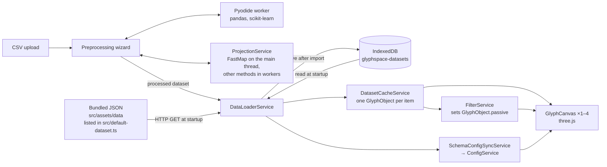

# Architecture

_For contributors who are new to the codebase and want the big picture before changing something._

Paths are relative to `src/app/` unless they start with `src/`, `tools/` or `docs/`.

GlyphSpace is a single-page Angular application with no backend and no router. Everything runs in the browser: data preparation in a Python runtime compiled to WebAssembly, dimensionality reduction in web workers, rendering in WebGL. The built site is static files (see [deployment.md](deployment.md)).

## Tech stack

| Concern | Library | Where |
|---|---|---|
| UI framework | Angular 22, standalone components, zone.js change detection (existing components eager, new ones OnPush, [ADR 0011](../decisions/0011-existing-components-keep-eager-change-detection.md)) | `src/main.ts` (`provideZoneChangeDetection`), `app.config.ts` (only `provideHttpClient`) |
| State and events | RxJS subjects in root services | `services/config.service.ts`, `services/filter.service.ts` |
| Canvas rendering | three.js (`WebGLRenderer`, orthographic camera) | `canvas/`, `glyph/renderers/` |
| Charts, colour scales, layout helpers | d3 (histogram brush, `scaleLinear`/`scaleQuantize`, `forceSimulation`, `quadtree`) | `sidebar/histogram/`, `shared/interfaces/color-scale.ts`, `canvas/`, `shared/helpers/glyph-helper.ts` |
| Dimensionality reduction | DruidJS 0.9 (`@saehrimnir/druidjs`) | `workers/druid-runner.ts`, `workers/projection.worker.ts`, `services/projection.service.ts` |
| Data preparation | Pyodide 314.0.7 (Python 3.14) from the jsDelivr CDN, with pandas 3.0 and scikit-learn 1.8 installed through micropip | `workers/pyodide.worker.ts`, `src/assets/preprocessing_processor*.py` |

## Module map

| Folder | Role |
|---|---|
| `app.component.*` | Root layout: menubar, a grid of one to four canvases, sidebar, toasts. `+` / `-` add and remove canvases. |
| `menubar/` | Dataset picker, deleting user datasets, Upload (opens the wizard), CSV download, PNG export, add canvas, fit all. |
| `canvas/` | `GlyphCanvasComponent` and its per-canvas services (camera, renderer, selection), magic lens, tooltip, the navigation and settings overlays. |
| `glyph/` | The data-item model (`GlyphObject`), per-canvas render cache, glyph configuration, size per zoom level, and the three.js glyph renderers. |
| `sidebar/` | The glyph legend and filter summary on top, the Filters and Encoding tabs below, the feature histograms that act as filters. |
| `preprocessing-wizard/` | The six-step CSV import wizard. See [wizard.md](wizard.md). |
| `services/` | Root services: configuration, filtering, dataset loading, cache, collection and storage, item images (`ThumbnailService`), CSV export, the Pyodide bridge (`DataProcessorService`), projections, toasts, logging. |
| `shared/` | Enums, the dataset-format interfaces, filter classes, helpers, constants and shared components (colour scale selector, mini histogram, toast). |
| `workers/` | `pyodide.worker.ts` (Python), `projection.worker.ts` (DruidJS), `druid-runner.ts` (DruidJS calls shared by the worker and the main thread), `pyodide-calls.ts` and `pyodide-files.ts` (safe Python calls and file names). |

Outside `src/app/`: `src/assets/data/` holds the bundled datasets, `src/default-dataset.ts` is the generated index of them, `src/assets/` also holds the Python modules, the sample CSV and the thumbnails, `src/styles/` the SCSS tokens and mixins, and `tools/` the command-line preprocessing (see [processing-pipeline.md](processing-pipeline.md)).

## Data flow

**Bundled datasets.** The `DataLoaderService` constructor requests the schema, meta, feature and position files of every dataset in `DEFAULT_DATASETCOLLECTION` (`src/default-dataset.ts`) from `assets/data/`, and builds each into the cache. The first dataset in collection order that loads becomes the active one, whatever order the downloads finish in. It also reads every dataset saved in IndexedDB into the cache.

**Imported datasets.** The wizard writes the uploaded CSV into the Pyodide file system, profiles it, and in Step 6 sends the configuration to Python (`DataProcessorService.processWithConfig`). Python returns the dataset (schema, meta, features) and writes the processed feature matrix to `processed_features.csv`. The wizard reads that file back, runs FastMap on the main thread as the primary projection, and starts the other selected methods in background workers. "Open in Glyphspace" hands the dataset to `DataLoaderService.loadProcessedDataset`, which builds it into the cache, and to `saveDatasetToStorage`, which saves it to IndexedDB. Background projections that finish later are added to the loaded dataset and saved again. A ZIP of item images chosen in Step 1 is attached to the dataset after FastMap (`ThumbnailService.attachArchive`). The details are in [wizard.md](wizard.md) and [processing-pipeline.md](processing-pipeline.md); the file formats are in [specs/dataset-format.md](../specs/dataset-format.md).

**From cache to screen.** `ConfigService.loadData(name)` emits the active dataset name. Every canvas then reads its `GlyphObject`s from the cache, scales the positions of the selected projection into canvas space and renders them. Filters and selections never remove items: `FilterService` marks them `passive`, and the canvases draw passive items in grey. See [dashboard.md](dashboard.md).

## Dataset sources

Every entry of the dataset collection (`shared/interfaces/dataset-collection.ts`, held by `DatasetCollectionService`) has a `source`:

| `source` | Comes from | File references in the collection entry | Can be deleted in the UI |
|---|---|---|---|
| `local` | Bundled with the app, listed in `src/default-dataset.ts` | File names, fetched from `assets/data/` | No |
| `wasm` | Produced by the wizard in this session | `memory://<name>/<timestamp>/<part>` | Yes |
| `indexeddb` | Saved wizard output, read at startup | `memory://<name>/<timestamp>/<part>` | Yes |

The `memory://` references are identifiers, not URLs: the data behind them is already in `DatasetCacheService` (and, for `indexeddb`, stored in IndexedDB under the dataset name). In practice nothing fetches them: `DataLoaderService.loadDataSet` would hand a `wasm` entry to the worker's `getJson`, but the cache always holds these datasets, so that path isn't reached. When `saveDatasetToStorage` succeeds, the entry's source changes from `wasm` to `indexeddb`. IndexedDB keys datasets by name, so saving a dataset under an existing name replaces it.

## Where state lives

| State | Owner | Lifetime |
|---|---|---|
| Active dataset name, colour feature and scale, glyph features, labels, feature types, glyph configuration, the event buses | `ConfigService` | Session |
| Active filters and filtered count; the result is written to `GlyphObject.passive` | `FilterService` | Session |
| `GlyphObject`s per dataset; schema and meta per dataset and timestamp | `DatasetCacheService` | Session |
| The dataset collection (which datasets, timestamps and projections exist) | `DatasetCollectionService` | Session |
| Per-canvas positions, meshes, visibility and clustering of every item | `GlyphObject.renderCache`, keyed by canvas id | Until the canvas is destroyed |
| Camera, scene, renderer, selection of one canvas | Component-level providers of `GlyphCanvasComponent` | Lifetime of the canvas |
| Wizard state (versioned) | `PreprocessingService`, saved under the localStorage key `glyphspace_preprocessing_state` | Across reloads. See [specs/wizard-storage.md](../specs/wizard-storage.md) |
| Imported datasets, and the ZIP archive of item images of each | `DatasetStorageService`, IndexedDB database `glyphspace-datasets`, stores `datasets` and `thumbnails` | Across reloads |
| The uploaded CSV and item image ZIP of the wizard | `WizardFileStore` (`preprocessing-wizard/services/wizard-file-store.ts`), IndexedDB database `glyphspace-wizard-files`, store `files` | Across reloads, until the wizard no longer references them. See [specs/wizard-storage.md](../specs/wizard-storage.md#uploaded-files) |
| Uploaded CSV files, `processed_features.csv`, unpacked item images (`/thumbnails-<n>/`) | The Pyodide file system in the worker | Lifetime of the worker (page); after a reload the wizard writes the uploaded CSV back, and `ThumbnailService` unpacks a dataset's archive again on first use |

Root services (`providedIn: 'root'`) are singletons shared by all canvases. `CanvasCameraService`, `CanvasRendererService` and `CanvasSelectionService` are listed in the canvas component's `providers`, so every canvas gets its own instances.

## Workers and lazy loading

- **Pyodide worker.** `DataProcessorService` creates `workers/pyodide.worker.ts` in its constructor. The service is injected by `DataLoaderService`, which the root component injects, so the worker starts with the app. The worker module starts loading Pyodide, pandas and scikit-learn as soon as it runs, so the runtime is usually ready by the time a user opens the wizard. Requests are handled one at a time; each carries a `requestId` that the reply echoes (except the fire-and-forget thumbnail request `getThumb`), and `DataProcessorService` rejects a request that gets no reply within 60 seconds. The message types are in `shared/interfaces/pyodide-messages.ts` and specified in [specs/worker-protocol.md](../specs/worker-protocol.md). The Python modules are fetched from `assets/` on first use. Why Python runs in the browser at all: [ADR 0002](../decisions/0002-preprocess-in-the-browser-with-pyodide.md); why no Python code is built from data: [ADR 0004](../decisions/0004-no-python-code-built-from-data.md).
- **Projection workers.** `ProjectionService` starts one `workers/projection.worker.ts` per background method, so each can be cancelled on its own. The worker imports DruidJS statically. FastMap, the primary projection, runs on the main thread; DruidJS is loaded there with a dynamic `import()` on its first use. See [ADR 0003](../decisions/0003-druidjs-projections-in-web-workers.md).
- **Wizard chunk.** The menubar renders the wizard inside `@if (showWizard)` and `@defer (on immediate)` (`menubar/menubar.component.html`), so its code is a separate chunk that loads when Upload is clicked.

## Further reading

- [dashboard.md](dashboard.md): canvases, glyphs, filters, sidebar
- [wizard.md](wizard.md): the import wizard
- [processing-pipeline.md](processing-pipeline.md): Python processing and projections
- [extending.md](extending.md): adding glyph types, colour scales, projection methods, error classes
- [specs/dataset-format.md](../specs/dataset-format.md): the dataset files
