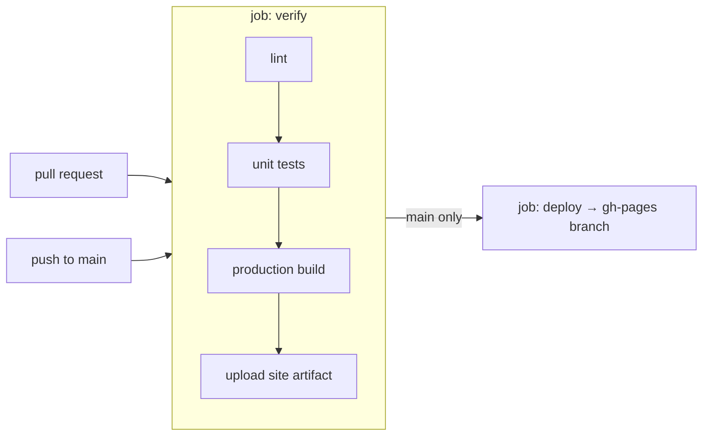

# Deployment

_For contributors who change the build, CI or hosting._

GlyphSpace is a static site. One GitHub Actions workflow, `.github/workflows/deploy.yaml`, checks every pull request and every push to `main`, and publishes `main` to GitHub Pages at [visual-engineers.org/glyphspace](https://visual-engineers.org/glyphspace/).

## Workflow

**verify** runs on every pull request and push (a newer run on the same ref cancels the older one):

1. `npm ci` with the Node version from `.nvmrc`.
2. `npm run lint`.
3. `npx playwright install --with-deps --only-shell chromium`, then `npm run test:ci` with `CHROME_BIN` cleared ([ADR 0009](../decisions/0009-unit-tests-in-real-chromium-with-vitest.md)).
4. `npm run build -- --base-href=/glyphspace/ --configuration production`.
5. Writes `.nojekyll` and copies `3rdpartylicenses.txt` into `dist/glyphspace/browser/`.
6. On `main` only: uploads `dist/glyphspace/browser/` as the artifact `site` (kept one day).

**deploy** runs only for pushes to `main`, after verify. It downloads the artifact and publishes it to the `gh-pages` branch with `peaceiris/actions-gh-pages` (Jekyll disabled). A running deploy is never cancelled (`cancel-in-progress: false`), but a deploy that is still waiting is replaced by a newer one, so only the latest of several quick pushes may be published.

Permissions follow least privilege: the workflow can only read the repository; the deploy job alone may write.

The Python tests are not part of CI.

## Build

- `ng build` with the production configuration writes `dist/glyphspace/`. Only `browser/` is published.
- Size budgets (`angular.json`): the initial bundle warns above 1.25 MB and fails above 1.7 MB; a component's styles warn above 40 kB and fail above 80 kB.
- `src/assets/` is copied as is, including the bundled datasets, thumbnails and the Python modules that the Pyodide worker fetches at runtime.
- `src/licenses/*.txt` is published as `licenses/`.
- The base href must match the Pages path (`/glyphspace/`). Assets are referenced relative to it (`assets/...`), so a different path only needs a different `--base-href`.

## Runtime dependencies outside the site

The deployed site loads Pyodide and its packages (pandas, scikit-learn) from `https://cdn.jsdelivr.net/pyodide/v<version>/full/` in the background when the app starts (the Pyodide worker is created at start-up). The version is `PYODIDE_VERSION` in `src/app/workers/pyodide.worker.ts`. Everything else is in the build.

## Licences

GlyphSpace is MIT licensed. It bundles DruidJS, which is LGPL-3.0-or-later, so the site ships the LGPL and GPL texts and a notice (`src/licenses/README.txt`) under `licenses/`, plus `3rdpartylicenses.txt` with the licences of all bundled packages. Keep these when changing the build. Check a new dependency's licence before adding it.
