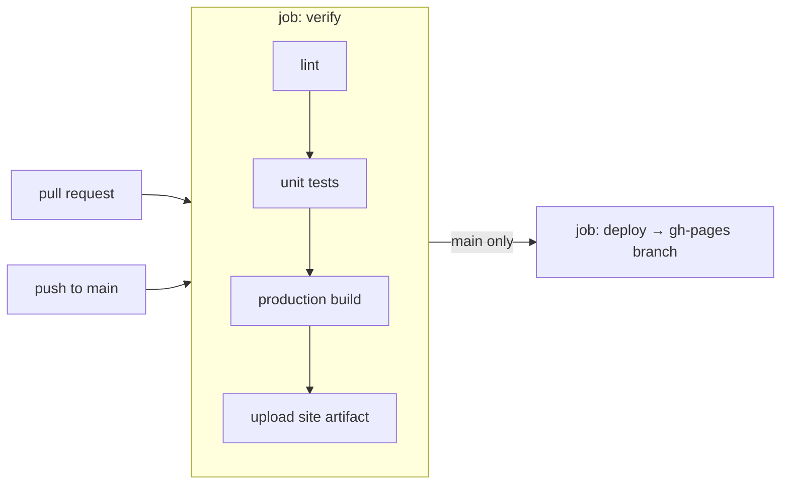

# Deployment

_For contributors who change the build, CI or hosting._

GlyphSpace is a static site. One GitHub Actions workflow, `.github/workflows/deploy.yaml`, checks every pull request and every push to `main`, and publishes `main` to GitHub Pages at [visual-engineers.org/glyphspace](https://visual-engineers.org/glyphspace/).

## Workflow

**verify** runs on every pull request and push (a newer run on the same ref cancels the older one):

1. `npm ci` with the Node version from `.nvmrc`.
2. `npm run lint`.
3. `npx playwright install --with-deps --only-shell chromium`, then `npm run test:ci` with `CHROME_BIN` cleared ([ADR 0009](../decisions/0009-unit-tests-in-real-chromium-with-vitest.md)).
4. `npm run build -- --base-href=/glyphspace/ --configuration production`.
5. Writes `.nojekyll` and copies `3rdpartylicenses.txt` into `dist/glyphspace/browser/`.
6. On `main` only: uploads `dist/glyphspace/browser/` as the artifact `site` (kept one day).

**deploy** runs only for pushes to `main`, after verify. It downloads the artifact and publishes it to the `gh-pages` branch with `peaceiris/actions-gh-pages` (Jekyll disabled). A running deploy is never cancelled (`cancel-in-progress: false`), but a deploy that is still waiting is replaced by a newer one, so only the latest of several quick pushes may be published.

Permissions follow least privilege: the workflow can only read the repository; the deploy job alone may write.

The Python tests are not part of CI.

## Build

- `ng build` with the production configuration writes `dist/glyphspace/`. Only `browser/` is published.
- Size budgets (`angular.json`): the initial bundle warns above 1.25 MB and fails above 1.7 MB; a component's styles warn above 40 kB and fail above 80 kB.
- `src/assets/` is copied as is, including the bundled datasets, thumbnails and the Python modules that the Pyodide worker fetches at runtime.
- `pyodide/` holds the wizard's Python runtime, about 40 MB ([ADR 0013](../decisions/0013-self-host-pyodide.md)): the Pyodide files from the `pyodide` npm package (`pyodide.mjs`, `pyodide.asm.mjs`, `pyodide.asm.wasm`, `python_stdlib.zip`, `pyodide-lock.json`) and the wheels of `src/app/workers/pyodide-packages.json` with their dependencies, which `tools/fetch-pyodide.mjs` downloads into `.pyodide-packages/` before every `npm run build` (the `prebuild` script). The script keeps a wheel only if its SHA-256 matches `pyodide-lock.json`, skips wheels it already has, and writes `THIRD-PARTY-LICENSES.txt` from the licence files in the wheels. Upgrading Pyodide means changing the `pyodide` version in `package.json`; everything else follows from its lock file.
- Critical CSS inlining is off (`optimization.styles.inlineCritical: false`): it loads the stylesheet with an inline `onload` handler, which the Content-Security-Policy blocks. The global stylesheet is about 1 kB.
- `src/licenses/*.txt` is published as `licenses/`.
- The base href must match the Pages path (`/glyphspace/`). Assets are referenced relative to it (`assets/...`), so a different path only needs a different `--base-href`.

## Runtime dependencies outside the site

None. The site serves everything it loads, including Pyodide and its Python packages ([ADR 0013](../decisions/0013-self-host-pyodide.md)); the browser contacts no other host.

## Content-Security-Policy

GitHub Pages can't send response headers, so `src/index.html` carries the policy as a `<meta http-equiv="Content-Security-Policy">` tag. It applies to the dev server too.

| Directive | Value | Why |
|---|---|---|
| `default-src` | `'self'` | everything not listed below: own origin only |
| `script-src` | `'self' 'wasm-unsafe-eval'` | the app's bundles and workers; no inline scripts. `'wasm-unsafe-eval'` lets Pyodide compile WebAssembly in browsers that apply the page's policy to its workers (Chromium doesn't; it gives the worker no policy because Pages sends no header) |
| `style-src` | `'self' 'unsafe-inline'` | Angular adds component styles as `<style>` elements, and d3 and the templates set `style` attributes; a nonce would need a server |
| `img-src` | `'self' data: blob:` | assets and item images; `data:`/`blob:` for images created in the browser |
| `font-src`, `connect-src`, `worker-src` | `'self'` | the icon font, the datasets, Python modules and Pyodide files, the workers |
| `object-src` | `'none'` | no plugins |
| `base-uri`, `form-action` | `'self'`, `'none'` | no `<base>` hijacking, no form posts |

A meta tag can't set `frame-ancestors`, so the policy doesn't prevent framing. When adding a feature that loads something from another origin, or uses an inline script, extend the policy here and in `src/index.html` together; a violation shows up as a console error.

## Licences

GlyphSpace is MIT licensed. It bundles DruidJS, which is LGPL-3.0-or-later, so the site ships the LGPL and GPL texts and a notice (`src/licenses/README.txt`) under `licenses/`, plus `3rdpartylicenses.txt` with the licences of all bundled packages. Keep these when changing the build. Check a new dependency's licence before adding it.
