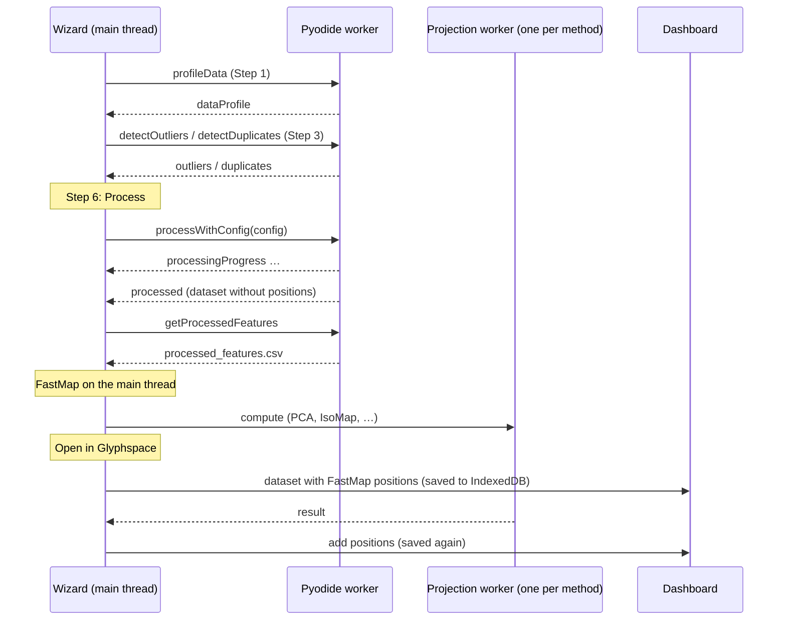

# Processing pipeline

_For contributors who change how an uploaded CSV becomes a dataset._

Paths are relative to `src/app/` unless they start with `src/`, `tools/` or `docs/`.

An uploaded CSV passes through three places: the Pyodide worker (Python: profiling, cleaning, encoding), the main thread (FastMap, hand-over to the dashboard) and one projection worker per background method (DruidJS). The contracts between them are specified in [Worker protocol](../specs/worker-protocol.md) and [Processing config](../specs/processing-config.md); the reasons for this split are in [ADR 0002](../decisions/0002-preprocess-in-the-browser-with-pyodide.md) and [ADR 0003](../decisions/0003-druidjs-projections-in-web-workers.md).

## Overview

## 1. Upload and profile (Step 1)

`PreprocessingService.loadCSV` sends the file to the worker (`profileData`). The worker writes it into its file system under the file's own name, where it stays for every later request, and runs `profile_data` (`src/assets/preprocessing_processor.py`): per column the detected type, counts, missing values, statistics and a histogram, plus ten preview rows and the duplicate count. `adoptLoadedFile` turns each column profile into a default config (`preprocessing-wizard/services/column-defaults.ts`, rules in [CSV input](../specs/csv-input.md#wizard)), as one undoable action. The file is also kept in IndexedDB (`WizardFileStore`), and so is an item image ZIP chosen in Step 1 (`setThumbnailArchive`).

After a page reload the worker's file system is empty. When `PreprocessingService` restores a state that names a file, `restoreUploadedFile` reads it from the file store and sends it to the worker again (`profileData`); requests that read the file (`detectOutliers`, `detectDuplicates`, processing) wait for this through `loadedFileName`. If that fails, for example because the file is not stored, the state gets `uploadMissing` and Step 1 asks for the file again. A re-uploaded file with the same columns keeps the restored settings (`adoptLoadedFile`, `sameColumns`). Details: [Wizard storage](../specs/wizard-storage.md#uploaded-files).

## 2. Live analysis (Step 3)

Step 3 asks the worker for outlier counts per column (`detectOutliers`) and the duplicate count (`detectDuplicates`) as the user changes settings. These run the same functions the pipeline uses later (`find_outliers`), so the counts match what processing removes or caps.

## 3. Process (Step 6)

`Step6ReviewProcessingComponent.startProcessing` runs the primary run inside `PreprocessingService.whileProcessing`, which keeps `isProcessing` up (and undo/redo disabled) until FastMap is done:

1. `PreprocessingService.processData` builds the config (`buildProcessingConfig`) and sends `processWithConfig`. Python fills, caps, drops, encodes and scales ([order of operations](../specs/processing-config.md#order-of-operations)), writes `processed_features.csv` and returns the dataset without positions. Progress messages drive the progress bar up to 70 %.
2. `getProcessedFeatures` fetches the CSV; `ProjectionService.parseCSVFeatures` reads it with a CSV parser (d3's `csvParseRows`, since pandas quotes ids that contain a comma) and turns it into a matrix and an id list.
3. `ProjectionService.runFastMapSync` loads DruidJS (first use only) and runs FastMap on the main thread.
4. `addProjectionPositions('fastmap', …)` stores the positions in the processed dataset (`storeProjectionPositions`).
5. If an item image ZIP was chosen in Step 1, `Step6ReviewProcessingComponent.attachThumbnails` hands it to `DataLoaderService.attachThumbnails` under the dataset name, without waiting for it; a toast reports the number of images found ([Dashboard](dashboard.md#thumbnails)).

A second click while a run is active is ignored; `processData` also returns the running promise instead of starting another.

## 4. Background projections

After the primary run, `startBackgroundProjections` starts every enabled, visible method from `preprocessing-wizard/steps/step6-review-processing/background-projections.ts`, each through `ProjectionService` in its own worker. `ProjectionService` publishes a status per method (pending, running, complete, error, cancelled) that Step 6 shows, and offers `cancel(method)`, `retry(method)` and `terminateAllWorkers()`. The primary run can't be cancelled: terminating the Pyodide worker would drop the loaded runtime and the uploaded file.

When a method finishes:

- if the wizard still holds the processed dataset, the positions are added to it, and the dataset is (re)loaded into the dashboard;
- if the wizard was already reset (the user opened the dashboard), the positions are added to the loaded dataset (`DataLoaderService.addPositionsToLoadedDataset`) and the dataset is saved to IndexedDB again.

Either way a toast reports the result. Failures are classified by `classifyBackgroundFailure` and shown as a dismissable warning; a cancelled run is silent.

## 5. Hand-over to the dashboard

"Open in Glyphspace" (`goToDashboard`):

1. adds the dataset to the collection as source `wasm` (`DataLoaderService.addProcessedDatasetToCollection`) and loads it (`loadProcessedDataset`): the cache is built, the schema is applied to `ConfigService`, filters are cleared;
2. saves it to IndexedDB (`saveDatasetToStorage`), so it survives a reload as source `indexeddb`;
3. detaches running background jobs (`ProjectionService.detachAll`): they keep computing for the dashboard but can no longer be cancelled from the wizard;
4. resets the wizard (`resetState`), which also clears the saved wizard state and prunes the worker's files and the file store.

## Errors

A failed request rejects with the worker's message. Processing errors are classified into K1–K8 by `classifyProcessingError` (`preprocessing-wizard/shared/constants/wizard-error-classes.ts`) and shown as an issue card with a "Fix in step N" link; `detectPreflightIssues` warns about K3, K4 and K6 before the run. See [Wizard](wizard.md#errors) and, for users, [Troubleshooting](../user-guide/troubleshooting.md).

## Bundled datasets (CLI)

`tools/process.py` is a separate pipeline in plain Python (pandas, scikit-learn, umap-learn) that writes bundled datasets into `src/assets/data/` and regenerates `src/default-dataset.ts`. It is not part of the app build and shares no code with the wizard's pipeline; the differences are listed in [CSV input](../specs/csv-input.md). Its tests are in `tools/tests/test_process_cli.py`.
