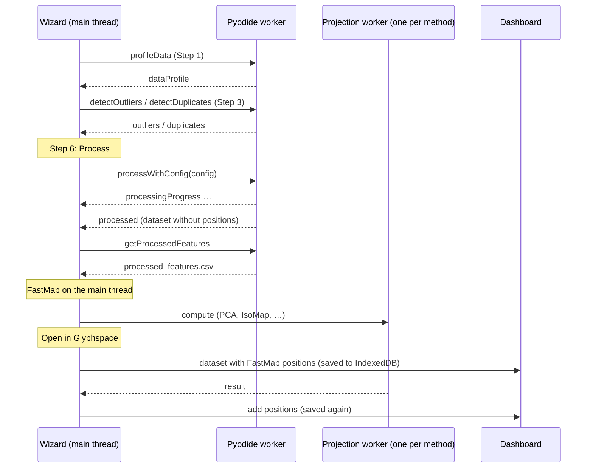

# Processing pipeline

_For contributors who change how an uploaded CSV becomes a dataset._

Paths are relative to `src/app/` unless they start with `src/`, `tools/` or `docs/`.

An uploaded CSV passes through three places: the Pyodide worker (Python: profiling, cleaning, encoding), the main thread (FastMap, hand-over to the dashboard) and one projection worker per background method (DruidJS). The contracts between them are specified in [Worker protocol](../specs/worker-protocol.md) and [Processing config](../specs/processing-config.md); the reasons for this split are in [ADR 0002](../decisions/0002-preprocess-in-the-browser-with-pyodide.md) and [ADR 0003](../decisions/0003-druidjs-projections-in-web-workers.md).

## Overview

## 1. Upload and profile (Step 1)

`PreprocessingService.loadCSV` sends the file to the worker (`profileData`). The worker writes it into its file system under the file's own name, where it stays for every later request, and runs `profile_data` (`src/assets/preprocessing_processor.py`): per column the detected type, counts, missing values, statistics and a histogram, plus ten preview rows and the duplicate count. `adoptLoadedFile` turns each column profile into a default config (`preprocessing-wizard/services/column-defaults.ts`, rules in [CSV input](../specs/csv-input.md#wizard)), as one undoable action. The file is also kept in IndexedDB (`WizardFileStore`), and so is an item image ZIP chosen in Step 1 (`setThumbnailArchive`).

After a page reload the worker's file system is empty. When `PreprocessingService` restores a state that names a file, `restoreUploadedFile` reads it from the file store and sends it to the worker again (`profileData`); requests that read the file (`detectOutliers`, `detectDuplicates`, processing) wait for this through `loadedFileName`. If that fails, for example because the file is not stored, the state gets `uploadMissing` and Step 1 asks for the file again. A re-uploaded file with the same columns keeps the restored settings (`adoptLoadedFile`, `sameColumns`). Details: [Wizard storage](../specs/wizard-storage.md#uploaded-files).

## 2. Live analysis (Step 3)

Step 3 asks the worker for outlier counts per column (`detectOutliers`) and the duplicate count (`detectDuplicates`) as the user changes settings. These run the same functions the pipeline uses later (`find_outliers`), so the counts match what processing removes or caps.

## 3. Process (Step 6)

A processing run belongs to `ProcessingRunService` (`preprocessing-wizard/services/processing-run.service.ts`), not to Step 6: Step 6 starts it (`start`) and renders its `status$`, so the run goes on when the wizard is closed, and reopening the wizard shows it where it is. A second press while a run is in its processing phase joins it. Each run keeps its own dataset name, timestamp and collection, and the inputs key it started with (`PreprocessingService.processingInputsKey`: the stored upload, the item-image ZIP and every setting sent to Python). The primary run runs inside `PreprocessingService.whileProcessing`, which keeps `isProcessing` up (and undo/redo disabled) until FastMap is done:

1. `PreprocessingService.processInWorker` builds the config (`buildProcessingConfig`) and sends `processWithConfig` with the upload key. Python fills, caps, drops, encodes and scales ([order of operations](../specs/processing-config.md#order-of-operations)), writes `processed_features.csv` and returns the dataset without positions. Progress messages drive the progress bar up to 70 %.
2. `getProcessedFeatures` fetches the CSV; `ProjectionService.parseCSVFeatures` reads it with a CSV parser (d3's `csvParseRows`, since pandas quotes ids that contain a comma) and turns it into a matrix and an id list. The ids stay the strings Python wrote; converting a numeric-looking id (`007`, `1.0`, a 19-digit id) would no longer match its item.
3. `ProjectionService.runFastMapSync` loads DruidJS (first use only) and runs FastMap on the main thread, with the input checks of every projection ([Worker protocol](../specs/worker-protocol.md#input-checks)): input of rank 0 or 1 is placed exactly without DruidJS, and NaN coordinates are an error instead of items without a position.
4. The positions are stored in the run's collection (`storeProjectionPositions`), and `PreprocessingService.adoptProcessingResult` makes it the wizard's result, if the inputs are still those the run started with.

A run is discarded as soon as its inputs change (any setting, another file, undo/redo, Start over or "Process Another Dataset"): it stops after the step it is in (the Python step itself can't be interrupted, see below), adopts nothing, its background projections are cancelled, and Step 6 shows the review again. `PreprocessingService` drops an adopted result the same way, in `updateState`, so a result never outlives the settings it was computed from. Step 6 offers Start Processing only when no setting makes processing impossible (`detectStartBlockers`: a missing upload, no feature or projection column, glyph features the settings don't produce).

## 4. Background projections

After the primary run, the run starts every enabled, visible method from `preprocessing-wizard/steps/step6-review-processing/background-projections.ts`, each through `ProjectionService` in its own worker. `ProjectionService` publishes a status per method (pending, running, complete, error, cancelled) for the current run's jobs, which Step 6 shows, and offers `cancel(method)`, `retry(method)` and `terminateAllWorkers()`; a newer job of the same method cancels the outdated one. The primary run can't be cancelled: terminating the Pyodide worker would drop the loaded runtime and the uploaded file.

When a method finishes, its positions go to the run it belongs to, never to whatever the wizard holds then:

- before "Open in Glyphspace", they are added to the run's collection and become part of the dataset when it is opened;
- after it, they are added to that dataset in the dashboard (`DataLoaderService.addPositionsToLoadedDataset`), which is saved to IndexedDB again;
- for a discarded run, nothing happens (it was cancelled).

A toast reports the result. Failures are classified by `classifyBackgroundFailure` and shown as a dismissable warning; a cancelled run is silent.

## 5. Hand-over to the dashboard

"Open in Glyphspace" (`ProcessingRunService.openInDashboard`), only for a finished, current run:

1. keeps the item-image ZIP chosen in Step 1 with the dataset (`DataLoaderService.attachThumbnails`, a toast reports the number of images), or, without one, removes any archive stored under the dataset name (`ThumbnailService.detachArchive`) ([Dashboard](dashboard.md#thumbnails));
2. adds the dataset, with every projection finished so far, to the collection as source `wasm` (`DataLoaderService.addProcessedDatasetToCollection`) and loads it (`loadProcessedDataset`): the cache is built, the schema is applied to `ConfigService`, filters are cleared. A dataset name taken since the upload gets ` (1)`, ` (2)`, …;
3. saves it to IndexedDB (`saveDatasetToStorage`), so it survives a reload as source `indexeddb`;
4. detaches running background jobs (`ProjectionService.detachAll`): they keep computing for this dataset but can no longer be cancelled from the wizard, and leave its status list;
5. resets the wizard (`resetState`), which also clears the saved wizard state and prunes the worker's files and the file store.

The dataset reaches the dashboard only this way: a run that is never opened leaves nothing behind.

## Errors

A failed request rejects with the worker's message. Processing errors are classified into K1–K8 by `classifyProcessingError` (`preprocessing-wizard/shared/constants/wizard-error-classes.ts`) and shown as an issue card with a "Fix in step N" link; `detectPreflightIssues` warns about K3, K4 and K6 before the run. The classification looks at the exception line of a Python traceback only, with quoted parts (the user's column names and values) removed. See [Wizard](wizard.md#errors) and, for users, [Troubleshooting](../user-guide/troubleshooting.md).

## Bundled datasets (CLI)

`tools/process.py` is a separate pipeline in plain Python (pandas, scikit-learn, umap-learn) that writes bundled datasets into `src/assets/data/` and regenerates `src/default-dataset.ts`. It is not part of the app build and shares no code with the wizard's pipeline; the differences are listed in [CSV input](../specs/csv-input.md). Its tests are in `tools/tests/test_process_cli.py`.

The dashboard opens the first dataset of `src/default-dataset.ts`, its first time and its first projection, so `discover_datasets` writes the list in a fixed order that does not depend on the file system:

- **Datasets:** those in `DATASET_ORDER` (`tools/process.py`; `wineqr`, then `nutrients`) first, the others alphabetically, ignoring case.
- **Times:** in date order (`ddmmyyyy` read as a date, not sorted as text).
- **Projections:** `PROJECTION_ORDER` (`tools/dataset_common.py`; UMAP, PCA, t-SNE), then the others (`epsg`, `<prefix>`) by name.

A test (`test_the_committed_dataset_list_is_up_to_date`) fails when `src/default-dataset.ts` differs from what the tool would write for `src/assets/data/`, order included.

An import writes its files into a temporary folder and copies them into `src/assets/data/` only when all of them are written, so a failure leaves no partial dataset. For small files the projections adapt: PCA lays out a file with a single feature along x, t-SNE lowers its perplexity to a third of the rows and UMAP its neighbours to one less than the rows, and a file with five rows or fewer gets no t-SNE and UMAP positions.
