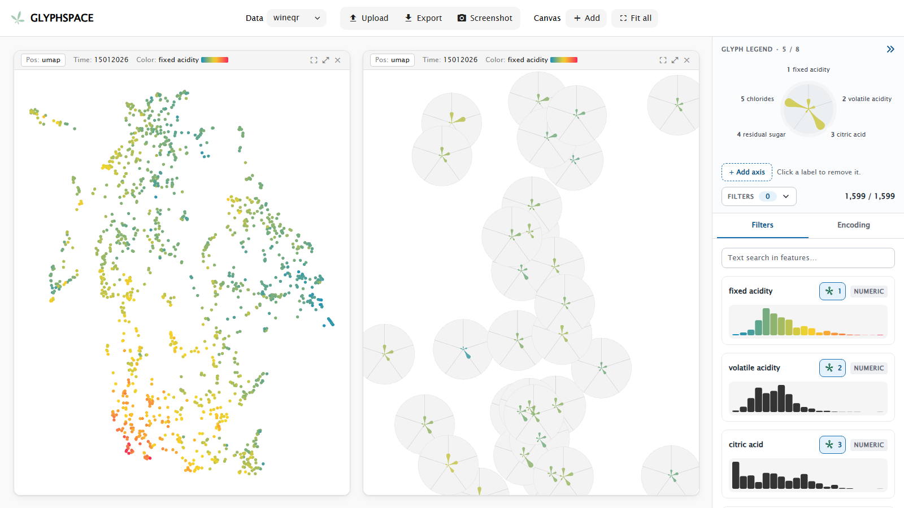

# Getting started

_For people who want to explore a dataset in GlyphSpace for the first time._

GlyphSpace places every row of a dataset as a point on a 2D map computed by a dimensionality reduction (projection): rows with similar values end up close together. When you zoom in, each point turns into a glyph, a small chart that shows several of the row's values at once.

## Open the app

- **Online:** the demo runs at <https://visual-engineers.org/glyphspace/>. Nothing to install.
- **Locally:** run `npm start` in the repository and open <http://localhost:4200/>. See [Development setup](../development/setup.md) for the prerequisites.

The app runs entirely in your browser, and your data never leaves your machine. You need an internet connection for importing a CSV: when GlyphSpace starts, it downloads the import wizard's Python runtime (Pyodide with pandas and scikit-learn) from the jsDelivr CDN in the background.

## Bundled datasets

Two datasets ship with the app and appear in the **Data** menu:

| Name | Content |
|---|---|
| `wineqr` | Wine Quality (red): physico-chemical measurements and a quality rating per wine, with a thumbnail image per item |
| `nutrients` | Nutrient values of foods |

`wineqr` is shown when the app starts (`nutrients` if `wineqr` can't be loaded). Datasets you import yourself appear in the same menu, marked **(uploaded)**.

## The screen at a glance

| Area | What it holds |
|---|---|
| **Menu bar** (top) | **Data**: choose the dataset. **Upload**: open the import wizard. **Export**: download the visible items as CSV. **Screenshot**: save the canvases as PNG. **Canvas**: **Add** a canvas, **Fit all** canvases to their content. On narrow screens the controls fold into the menu button. |
| **Canvas grid** (centre) | One to four canvases, each showing the dataset in a projection of its own. See [Dashboard](dashboard.md). |
| **Sidebar** (right) | On top, the glyph legend (which features the glyph shows) and **FILTERS** (the active filters and how many items match them). Below, two tabs: **Filters** (search and histograms) and **Encoding** (glyph type, colour, sizes). The double chevron hides the sidebar. See [Encoding and filters](encoding-and-filters.md). |

## A first tour

1. Hover over a point. After a moment a tooltip lists the item's values.
2. Scroll to zoom in. Past a certain zoom level the points become glyphs.
3. Drag to pan. Press **F** (with the mouse over the canvas) to fit everything back into view.
4. In the sidebar's **Filters** tab, drag across a histogram. Items outside that range turn grey.
5. Open the **Encoding** tab and switch between **Star** and **Flower** under **GLYPH TYPE**.

## Try the import with sample data

1. Click **Upload** in the menu bar. The **Data Preprocessing Wizard** opens.
2. In Step 1, click **Try with sample data**. It loads the Wine Quality (red) CSV (P. Cortez et al., UCI Machine Learning Repository, CC BY 4.0).
3. Click through the steps with the button at the bottom right. The defaults work for this file.
4. In Step 6, click **Start Processing**, then **Open in Glyphspace**.

The new dataset is selected in the **Data** menu and stays available after a reload. [Importing data](importing-data.md) explains every step.

## Next

- [Dashboard](dashboard.md): canvases, navigation, selection, magic lens and export
- [Encoding and filters](encoding-and-filters.md): the sidebar
- [Importing data](importing-data.md): the wizard, step by step
- [Preparing data](preparing-data.md): getting a CSV ready, or bundling a dataset with the app
- [Troubleshooting](troubleshooting.md)
